<picture>
  <source media="(prefers-color-scheme: dark)" srcset="https://readme-typing-svg.demolab.com?font=Fira+Code&weight=600&size=21&duration=2800&pause=900&color=58A6FF&center=true&vCenter=true&width=440&height=44&lines=MS%20AI%20at%20BTU%20Cottbus;RAG%20and%20LLM%20evaluation;AI%20for%20climate-policy%20workflows;Agents%20and%20automation" />
  <source media="(prefers-color-scheme: light)" srcset="https://readme-typing-svg.demolab.com?font=Fira+Code&weight=600&size=21&duration=2800&pause=900&color=0969DA&center=true&vCenter=true&width=440&height=44&lines=MS%20AI%20at%20BTU%20Cottbus;RAG%20and%20LLM%20evaluation;AI%20for%20climate-policy%20workflows;Agents%20and%20automation" />
  
</picture>

  
  
  
  

## 🧭 About Me

- 🎓 **MS Artificial Intelligence** at BTU Cottbus-Senftenberg
- 🔭 Experience: **AI & Mitigation internship @ UNFCCC**, building AI tooling for climate-policy workflows
- 🧠 Into: **RAG systems, LLM evaluation, QLoRA fine-tuning, knowledge graphs, agentic workflows**
- ⚙️ Philosophy: if a workflow is boring, it should automate itself

## ⚡ Selected Work

| Project | What it does |
|---|---|
| 📊 **[AI subscriptions](https://github.com/rahuloruganti/hermes-ai-subscriptions)** | AI quota and token usage for Hermes Desktop, Claude Code and Grok CLI. Accepted into the [plugin catalog](https://github.com/NousResearch/hermes-agent/pull/141121). |
| 📝 **[OpenMeet](https://github.com/rahuloruganti/OpenMeet)** | Local-first meeting recording, transcription and AI notes. Preview: audio/transcription unvalidated; Mac untested. |
| 🧪 **[RAG test generation](https://github.com/rahuloruganti/rag-testcase-generation)** | RAG/FAISS test-generation experiment. Pipeline integration and evaluation unfinished. |
| 🏛️ **[BTU Course MCP](https://github.com/rahuloruganti/btu_course_mcp)** | Searches BTU courses, schedules and module details through MCP for Claude Desktop. |
| 🎙️ **[pass-the-mic](https://github.com/rahuloruganti/pass-the-mic)** | Voice roundtable [fork](https://github.com/Chandukasireddy/pass-the-mic). I added [guided personas and peer-aware prompts](https://github.com/rahuloruganti/pass-the-mic/commit/2c5fa1767db7a323770c07beeddd4c2b85c0f118). |
| 🌱 **BetterMe** | Private habit builder with challenges and achievements. Next.js, React, Supabase. |

## 🛠️ Tech Stack

  <b>AI/ML:</b> Hugging Face · LangChain · FAISS · DVC · MCP &nbsp;|&nbsp; <b>Automation:</b> n8n · Power Automate

## 📟 Live Terminal

  

## 🧬 Languages & Activity

  
  

## 🔥 GitHub Streak

  

## 🐍 Contribution Snake

<picture>
  <source media="(prefers-color-scheme: dark)" srcset="https://raw.githubusercontent.com/rahuloruganti/rahuloruganti/output/github-contribution-grid-snake-dark.svg" />
  <source media="(prefers-color-scheme: light)" srcset="https://raw.githubusercontent.com/rahuloruganti/rahuloruganti/output/github-contribution-grid-snake.svg" />
  
</picture>

